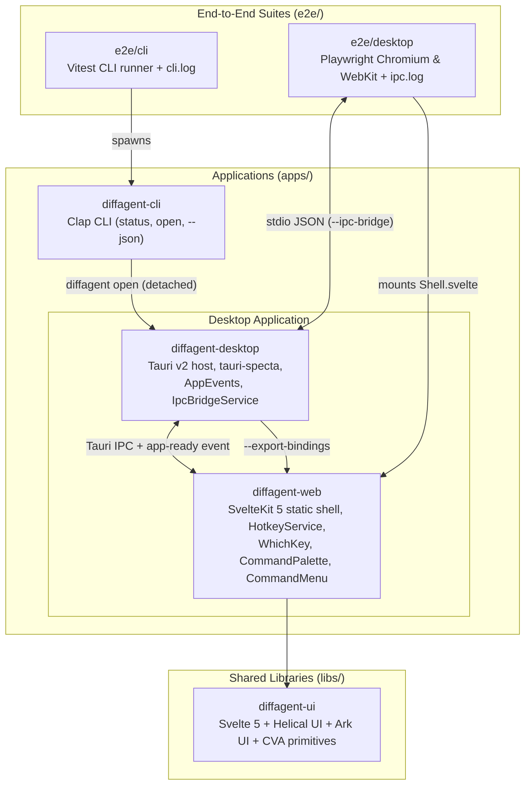
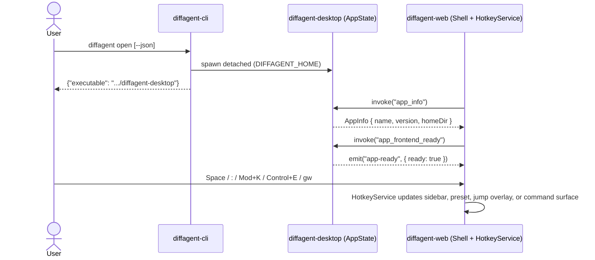

# Diffagent software architecture

## Overview

Diffagent is an open-source workspace for declarative local and cloud coding agents that synchronize through Git. The current baseline provides the Premise monorepo scaffold: a Rust CLI (command-line interface) launcher, a Tauri v2 desktop host with generated TypeScript IPC (inter-process communication) bindings, a static SvelteKit 5 web shell with modal `WhichKey` and command surfaces, a portable Helical UI (user interface) component library, and TypeScript E2E (end-to-end) test suites. Declarative agent schemas, execution runners, Git sync engines, workspaces, custom themes, and databases remain out of scope for this baseline.

## Requirement

### Functional

- Query CLI status, version, and active home directory in human-readable text or structured JSON.
- Launch the native desktop application from the CLI without blocking the calling terminal or requiring path arguments.
- Navigate the desktop application shell, sidebar, and command surfaces from the keyboard with modal shortcuts and searchable command discovery.
- Synchronize desktop host metadata and startup readiness between the native host and frontend UI.

### Non-Functional

- Keep local CLI inspection commands read-only so querying help, version, or status never writes to the user's home directory.
- Isolate development and test runs from the user's personal `~/.diffagent` state directory so automation never alters user data.
- Support cross-platform execution across Linux, macOS, and Windows while keeping CLI execution independent of native desktop runtime libraries.
- Keep desktop shell startup and keyboard navigation responsive offline without requiring a remote server.

## Design

### Components and Responsibilities



- `apps/diffagent-cli` parses CLI flags with Clap, formats terminal and `--json` output through view models in `src/models/`, reports `status`, and spawns `diffagent-desktop` detached on `diffagent open`.
- `apps/diffagent-desktop` hosts the native Tauri v2 webview (`com.diffagent.desktop`), manages `AppState` and `AppEvents`, exports TypeScript bindings via `tauri-specta`, and serves headless newline-delimited JSON IPC over `tauri::test::MockRuntime` when started with `--ipc-bridge <home>`.
- `apps/diffagent-web` compiles to static HTML and assets (`@sveltejs/adapter-static`) consumed by `apps/diffagent-desktop`, wiring `WhichKeyProvider`, `WhichKey`, `WhichKeyMode`, `CommandProvider`, `CommandPalette`, `CommandMenu`, `SidebarProvider`, and `HotkeyService`.
- `libs/diffagent-ui` packages reusable app-agnostic Svelte 5 primitives (`EmptyState`) built on `@cloudvoyant/helical-ui`, `@ark-ui/svelte`, and `class-variance-authority`.
- `e2e/cli` and `e2e/desktop` verify compiled CLI binaries and real Rust IPC handlers from TypeScript using Vitest and Playwright across Chromium and WebKit.

### Data and Control Flow



### Interfaces and Contracts

```sh
# User CLI commands (binary: diffagent)
diffagent [--help | --version]
diffagent status [--json]
diffagent open [--json]

# Desktop host utility flags (binary: diffagent-desktop)
diffagent-desktop --export-bindings [OUTPUT_PATH]
diffagent-desktop --ipc-bridge <HOME_DIR>
```

| Boundary                             | Request / Input                    | Response / Output                                                                              |
| ------------------------------------ | ---------------------------------- | ---------------------------------------------------------------------------------------------- |
| `diffagent status --json`            | `DIFFAGENT_HOME` (optional)        | `{ "version": "0.1.0", "home_dir": "<path>" }`                                                 |
| `diffagent open --json`              | `DIFFAGENT_DESKTOP_BIN` (optional) | `{ "executable": "<path>" }`                                                                   |
| CLI `--json` error (exit `1` or `2`) | Invalid flag or missing binary     | `{ "error": { "code": "invalid_argument \| not_found \| command_failed", "message": "..." } }` |
| `app_info` (Tauri IPC)               | none                               | `AppInfo { name: string, version: string, homeDir: string }`                                   |
| `app_frontend_ready` (Tauri IPC)     | none                               | `null` plus webview event `app-ready` (`{ ready: true }`)                                      |

## Implementation

### Runtime storage and E2E outputs

| Path                                | Owner                                | Purpose                                                                       |
| ----------------------------------- | ------------------------------------ | ----------------------------------------------------------------------------- |
| `~/.diffagent`                      | `diffagent-cli`, `diffagent-desktop` | Default user home directory when `DIFFAGENT_HOME` is unset                    |
| `<worktree>/.tmp/diffagent-home`    | Root `mise.toml`                     | Automatic worktree-local `DIFFAGENT_HOME` during development tasks            |
| `e2e/outputs/cli/<spec>/<slug>/`    | `e2e/common/test-harness.ts`         | Retained `cli.log` transcript and isolated `diffagent-home/` per CLI test     |
| `e2e/outputs/desktop/shell/<slug>/` | `e2e/desktop/fixtures.ts`            | Retained `ipc.log` transcript and isolated `diffagent-home/` per browser test |
| `e2e/desktop/playwright-report/`    | Playwright                           | HTML run report generated by `e2e/desktop`                                    |
| `e2e/desktop/test-results/`         | Playwright                           | Failure screenshots and traces captured by Playwright                         |

## References

- [Repository guidance](../../AGENTS.md).
- [Environment variables reference](../environment.md).
- [End-to-end test suite guide](../../e2e/README.md).
- [Workspace task configuration](../../mise.toml).
- [Premise workspace manifest](../../premise.yaml).
