# PRD: declarative bot console and observability

- Status: draft
- Owner: Diffagent team
- Date: 2026-11-20
- Related ADRs: [Software architecture](../../docs/architecture/index.md)

## Summary

Diffagent v0 is an open-source alternative to Grok Bot. Each declarative bot runs its harness locally (`~/.diffagent/bots/{name}`) or on an authorized remote Diffagent server, independent of cloud or local LLM inference. An avatar-only left rail selects bots or opens a `+` creation slot above a square-tile connectors hub and user avatar menu, while centered top tabs (`Chat`, `Stats`, `Sessions`, `Traces`) and a right-hand `Settings` sidebar operate bots across Slack, Discord, and web apps.

## Problem and Evidence

Closed bot platforms such as Grok Bot lock bot definitions and runtime state inside proprietary cloud VMs, while open-source stacks split chat, connectors, skills, approvals, and Langfuse-style tracing across separate tools.

## Users and Use Cases

- Bot developers defining declarative bots and skills at `~/.diffagent/bots/{name}` or on a remote Diffagent server
- Builders operating bots across Slack, Discord, and web apps from one desktop console
- Operators inspecting tool approval gates, sessions, traces, latency, and cost

## Goals

- Grok Bot macOS-style top-to-bottom avatar rail with `+` new-bot slot, apps/connectors icon, and user avatar account menu (no search, collapse, or bottom footer)
- Full-width top bar with logo on the left, centered `Chat`, `Stats`, `Sessions`, and `Traces` tabs, and far-right `Settings` opening a right sidebar
- Minimal bot creation (avatar shape/color and name; automatic directory) with post-creation configuration of skills (`skills/{name}/SKILL.md`), connectors, and channels
- Square-tile Connectors grid with brand icons and custom MCP registration
- Per-bot local or remote Diffagent harness execution with Langfuse-style observability

## Non-Goals

- Projects, repository workspaces, wikis, and task boards
- Multiple local chat threads per bot (`New chat`)
- Visual node-graph workflow builders

## Proposed Experience

### First-run empty state and bot creation

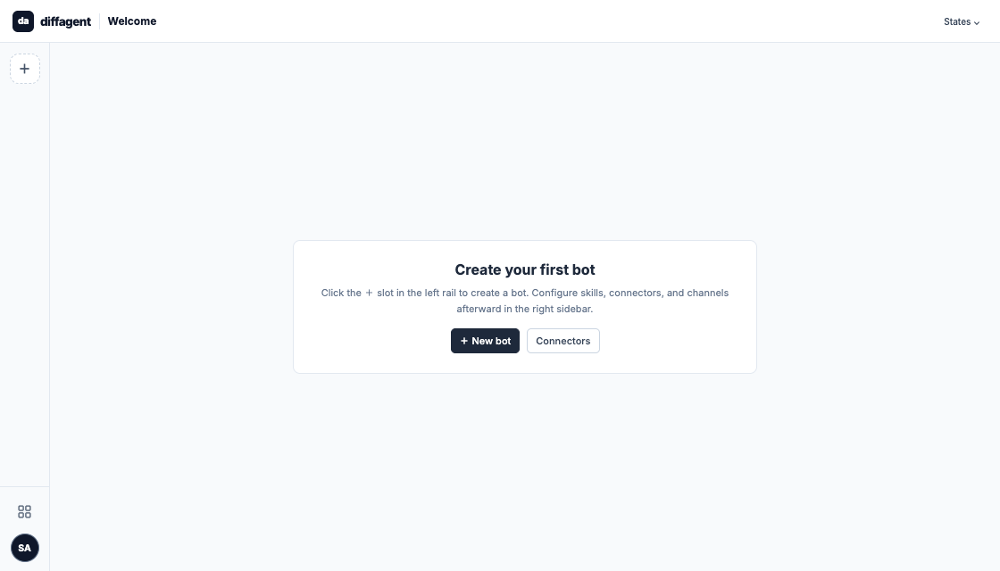

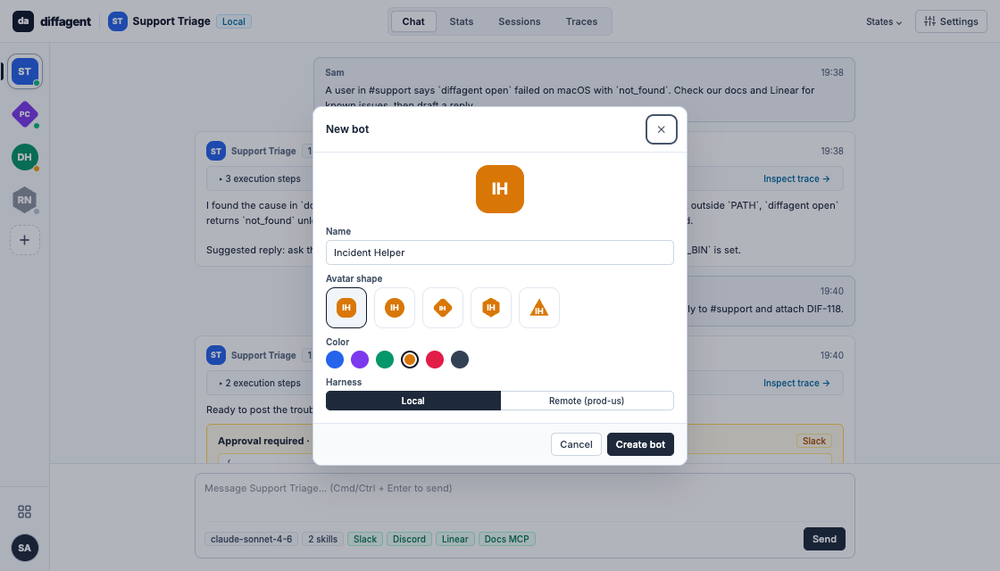

### Bot chat (local harness, remote server, and approval gates)

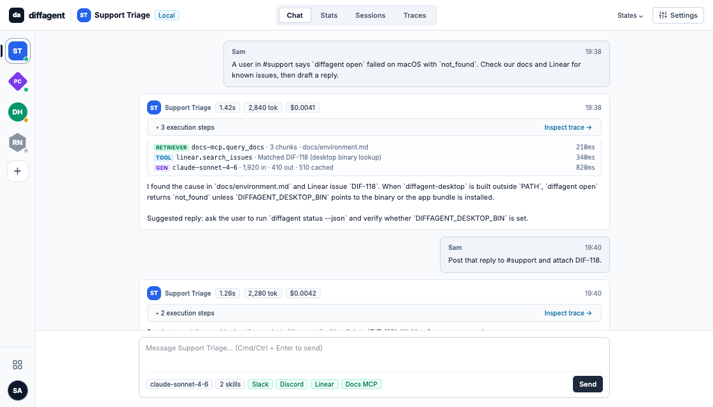

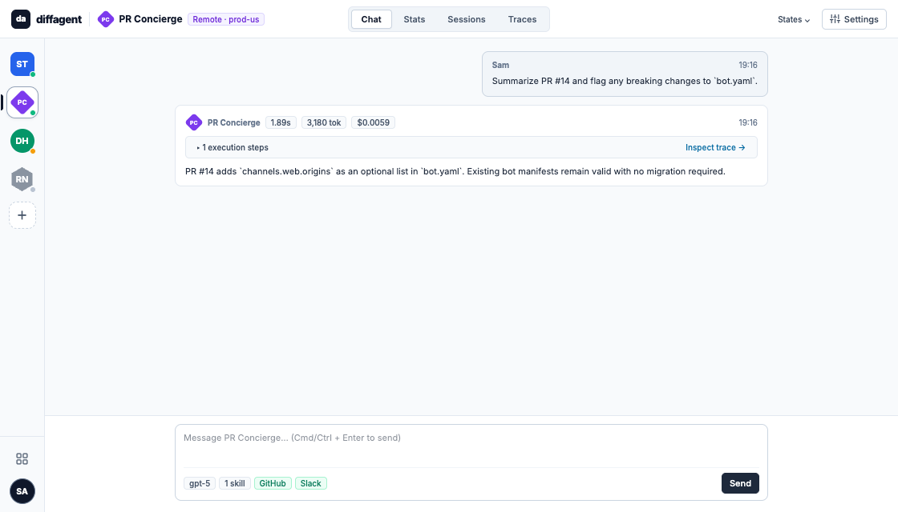

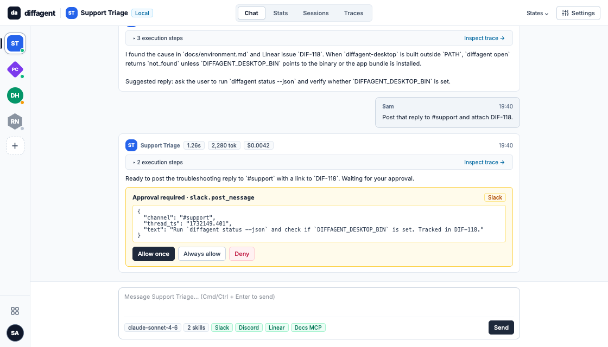

### Stats

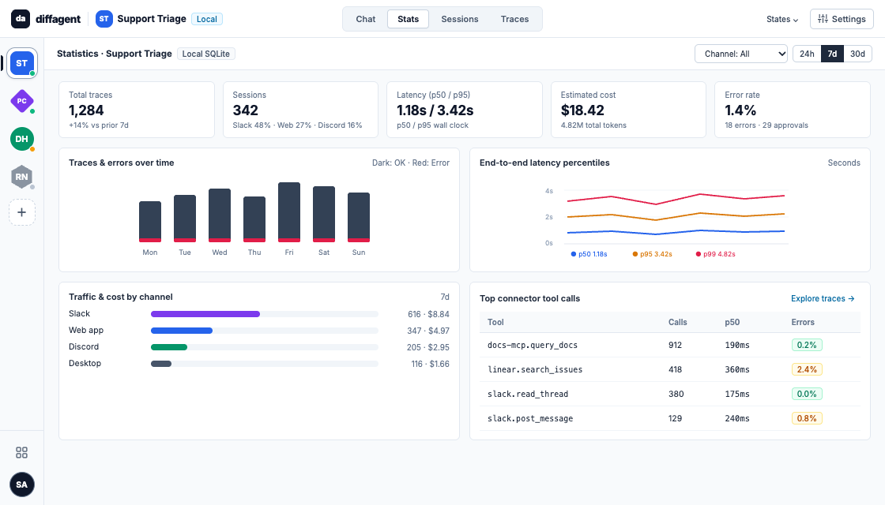

### Sessions

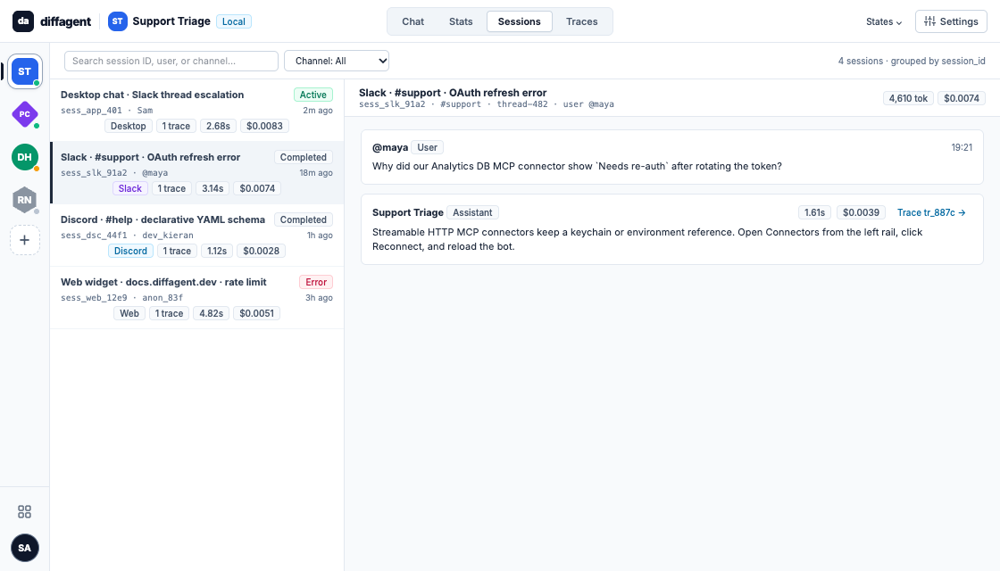

### Traces and waterfall detail

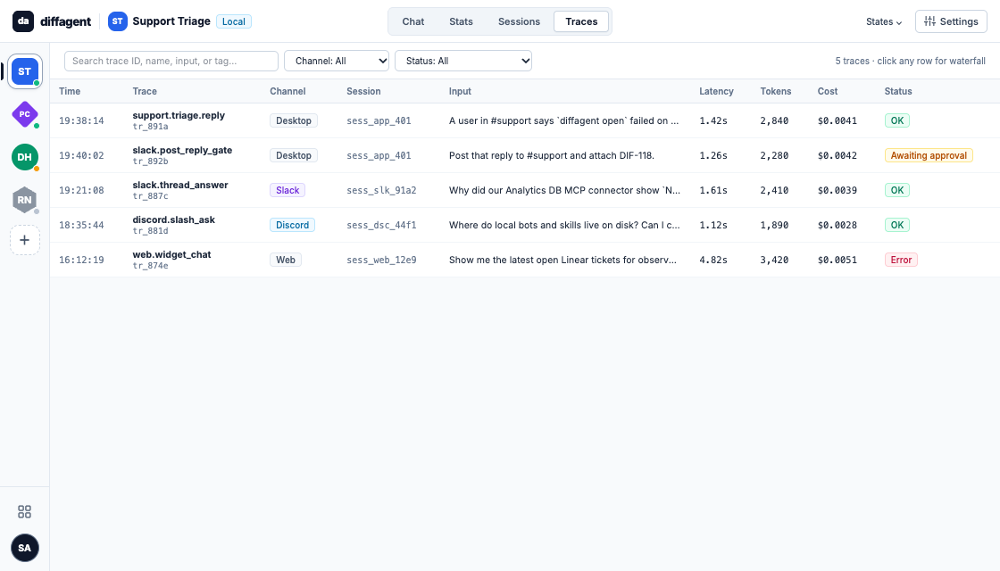

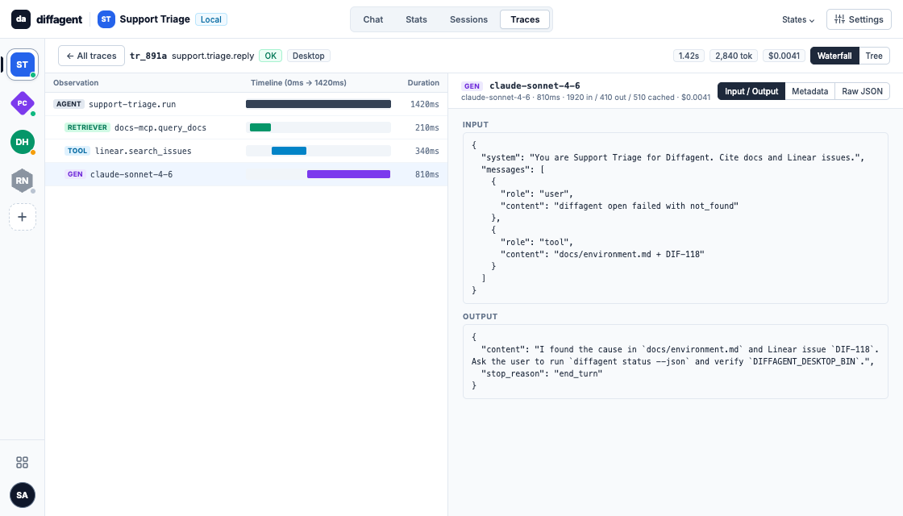

### Bot settings right sidebar (general, skills, connectors, channels, files)

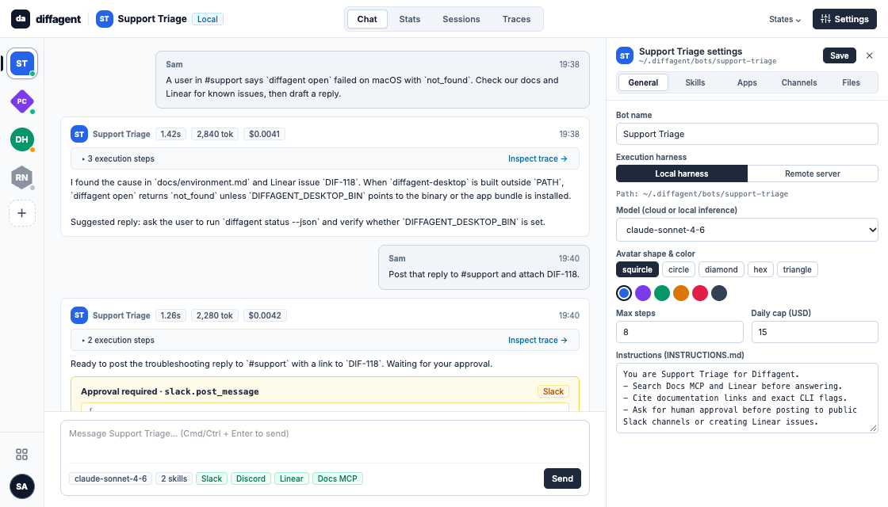

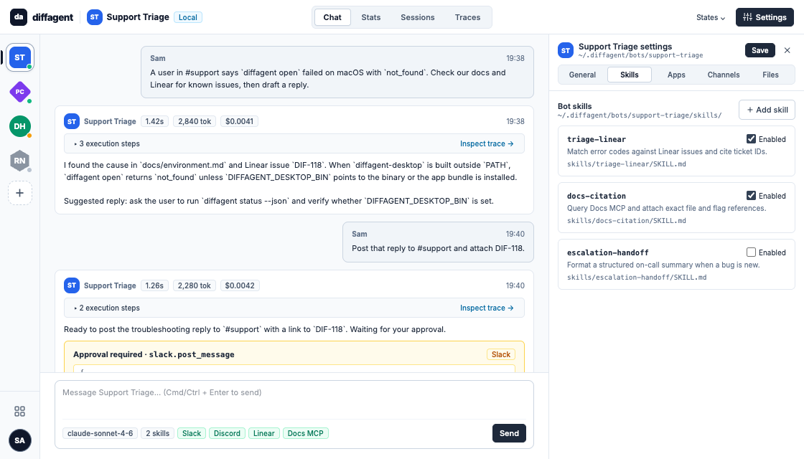

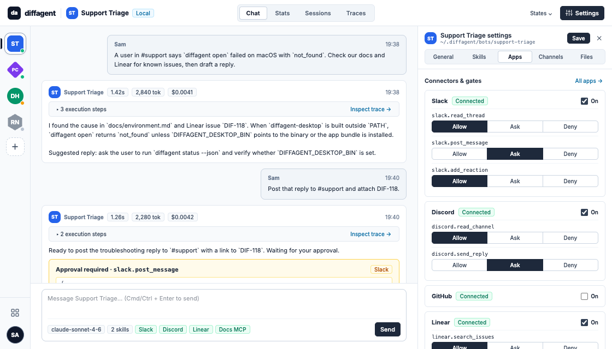

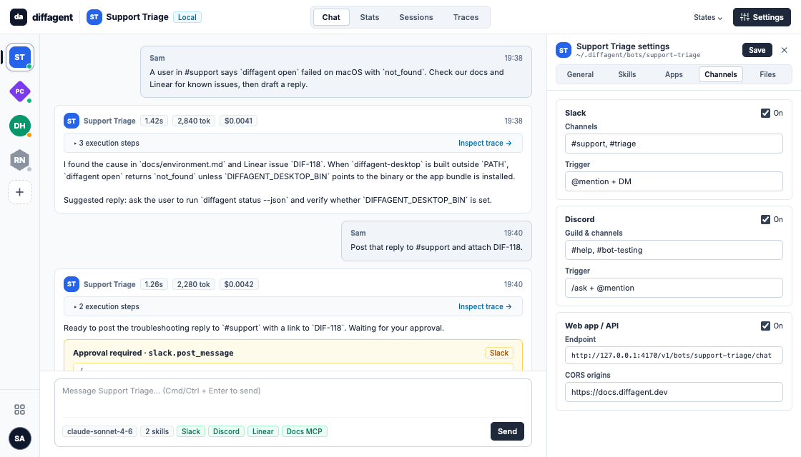

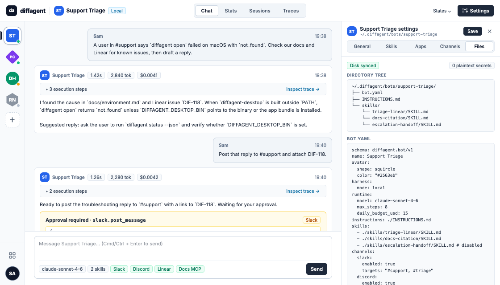

### Connectors square tiles and custom MCP

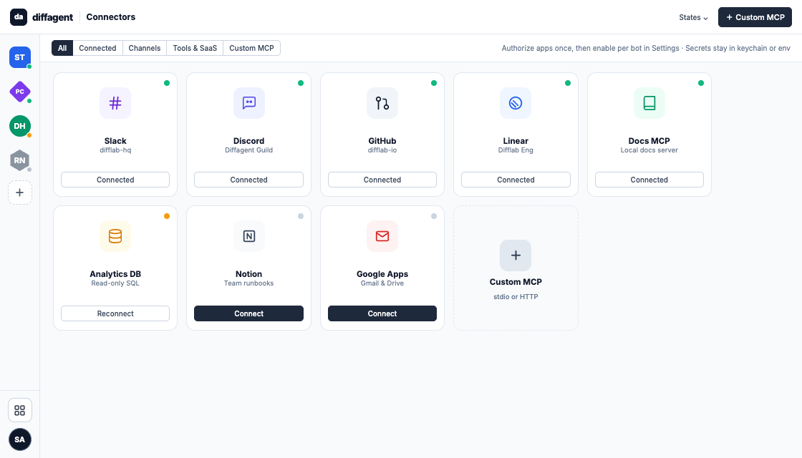

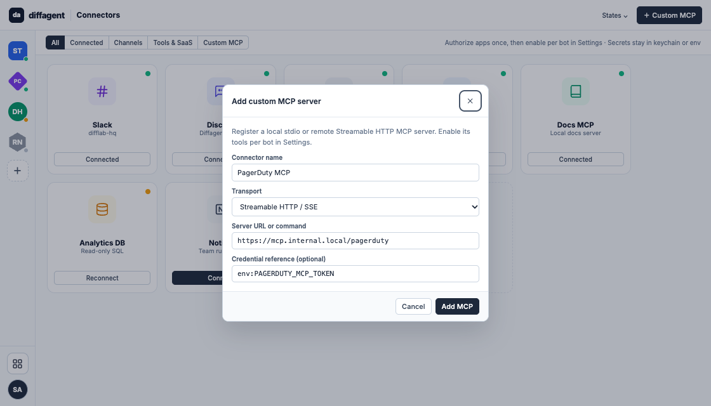

### User avatar menu and user settings

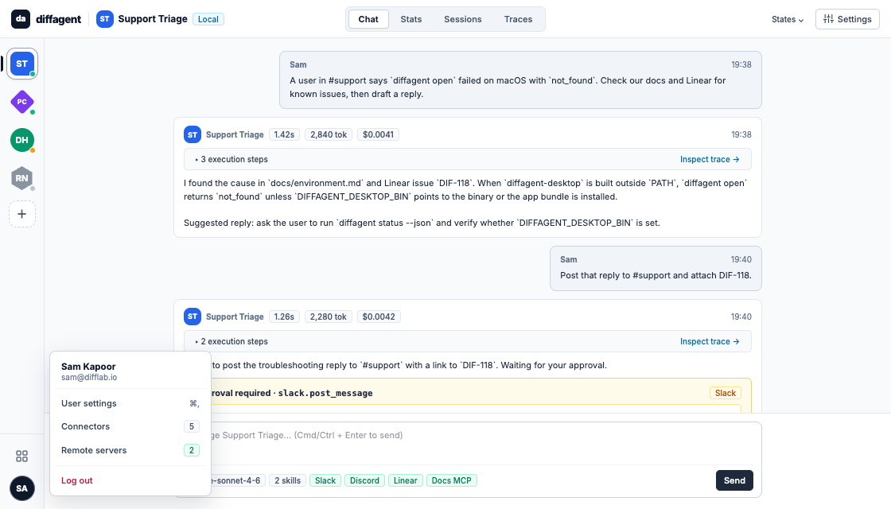

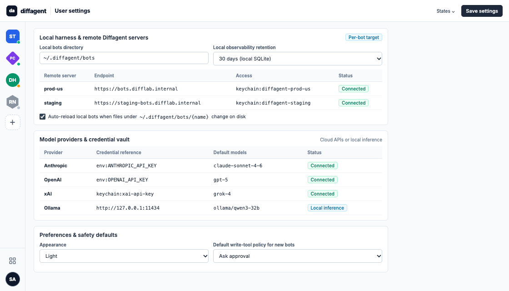

## Requirements

### R1. Per-bot local or remote harness and directory skills

Priority: HIGH

Acceptance: Each bot runs on a local harness (`$DIFFAGENT_HOME/bots/{slug}/`) or an authorized remote Diffagent server with `bot.yaml`, `INSTRUCTIONS.md`, and `skills/{skill}/SKILL.md` containing zero plaintext secrets.

### R2. Avatar-only left rail, `+` creation slot, apps icon, and user menu

Priority: HIGH

Acceptance: The left rail runs top-to-bottom without collapse or search, listing bot avatars, a `+` slot for new bots, a four-cube Connectors icon, and a user avatar menu with settings and log out. No bottom footer bar exists.

### R3. Top bar navigation and right-hand bot settings sidebar

Priority: HIGH

Acceptance: The top bar displays the Diffagent logo and bot title on the left, centers `Chat`, `Stats`, `Sessions`, and `Traces` tabs, and toggles the right-hand bot `Settings` sidebar from the far right.

### R4. Minimal bot creation flow

Priority: HIGH

Acceptance: Creating a bot requires only an avatar shape/color selector and bot name (plus optional local/remote target); the directory slug is derived automatically, and skills, connectors, and channels are configured afterward in the right sidebar.

### R5. Persistent bot chat and inline tool approval gates

Priority: HIGH

Acceptance: Selecting a bot opens its persistent desktop chat (no `New chat`) with collapsible execution steps, trace jump links, and `Allow once`, `Always allow`, or `Deny` approval cards.

### R6. Langfuse-style Stats, Sessions, and Traces tabs

Priority: HIGH

Acceptance: Centered `Stats`, `Sessions`, and `Traces` tabs provide time/channel KPIs, multi-channel session transcripts, and a split-pane `Waterfall` / `Tree` observation inspector across Desktop, Slack, Discord, and Web runs.

### R7. Square-tile Connectors hub and custom MCP

Priority: HIGH

Acceptance: Clicking the left-rail apps icon opens a square-tile grid with brand icons, connection states, and a `+ Custom MCP` tile using keychain or environment credential references.

### R8. User settings and remote Diffagent servers

Priority: MEDIUM

Acceptance: User settings opened from the bottom-left avatar menu manages local home directory, connected remote Diffagent servers, model provider references, retention, and default write-tool policies.

## Success Measures

## Risks and Dependencies

## Open Questions

## Rollout
